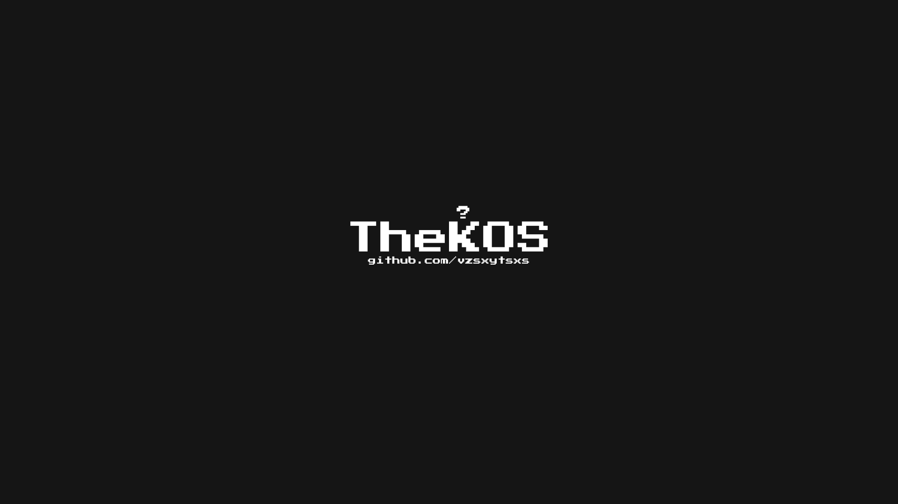

# KOS-W11



KOS-W11 is an experimental, community-driven project based on Windows 11, aimed at performance, low latency, privacy and customization. The repository holds the image build preset, post-install scripts, system tweaks, diagnostic utilities and support resources.

> [!WARNING]
> This project makes deep modifications to Windows, including removing components and changing services, policies, devices and security mechanisms. It is recommended only for experienced users, test machines and environments where data loss or incompatibilities can be recovered from. Do not use it on a production machine without reviewing the scripts and keeping a full backup.

## Project status

- Current development base: **Windows 11 Pro 26H2 x64 (en-US)**, always on the latest build available when the ISO is generated.
- Identification present after installation: **KOS-W11 4.0.0**.
- The project is under development and the build process is not yet fully automated.
- The legacy updater metadata still uses the number `358` and needs to be aligned with version 4.0.0.

KOS-W11 is not affiliated with, endorsed by or maintained by Microsoft.

## Goals

- Reduce processes and components considered unnecessary for the project's usage profile.
- Offer tweaks for gaming, latency, power, networking and responsiveness.
- Automate the initial setup and the installation of essential components.
- Centralize diagnostic, maintenance and support tools.
- Let advanced users study and customize their own Windows image.

## Main features

- NTLite preset for customizing Windows 11.
- Post-install script that runs on first logon.
- Registry, services, BCD, power, network and interface tweaks.
- Separate settings for AMD, Intel and NVIDIA GPUs.
- Browser installation and configuration.
- Power plans and optional experimental tweaks.
- Tools for diagnostics, cleanup, drivers and monitoring.
- Support scripts to restore specific services and features.
- Legacy incremental update system.

## Repository structure

```text
KOS-W11/
├── archived/      # Old files kept as reference
├── building/      # NTLite preset and image preparation
├── src/           # Files copied into the Windows image
│   ├── ProgramData/TheKOS/
│   │   ├── Setup/ # Installation, drivers, support, tweaks and cleanup
│   │   ├── bin/   # Dependencies used during post-setup
│   │   └── tools/ # Portable utilities and diagnostic tools
│   └── Windows/   # RunOnce script and files integrated into the system
├── test/          # Local experiments; ignored by Git
├── updates/       # Legacy incremental updates
└── wallpapers/    # Images and visual identity
```

The configuration menu installed in `ProgramData\TheKOS\Setup` is organized into the following steps:

1. Browser installation and configuration.
2. Driver installation and tweaks.
3. Support, fixes and Windows features.
4. Tweaks for apps, games, network and power.
5. System cleanup.
6. Miscellaneous resources.

## Development requirements

- A computer or virtual machine running Windows.
- An original, legitimate Windows 11 ISO.
- An NTLite version compatible with the project's preset.
- Free space to extract, mount and rebuild the image.
- Administrator privileges.
- A VM with snapshots to validate the image before using it on real hardware.

## Building the image

> [!IMPORTANT]
> NTLite is still manual; from there on, `building/build.cmd` does the rest. Review each step before running it.

Current development flow:

1. Get an original Windows 11 26H2 ISO from an official channel and extract it to `C:\base`. Its `boot.wim` must carry the boot signed with the new Secure Boot certificate (`Windows\Boot\EFI_EX`, `FONTS_EX` and `DVD_EX`, present since the April 2024 updates); the official 26H2 ISO has it.
2. Create a test virtual machine and a clean snapshot.
3. Import `building/ntlite.xml` into NTLite, confirm that the image version matches the one the preset expects and review the components marked for removal.
4. Run `building/build.cmd` (asks for administrator). **T** (test) and **R** (release) do everything: they mount `install.wim`, run the steps in `building/steps/install` (copy `src/`, remove Recall, ResetBase, .NET 3.5 and removal of `sources\sxs`, `prepareiso.cmd`, catroot2, Chinese, Japanese and Korean fonts, modem, IrDA and smart card drivers, IME, F12 and the 32-bit voice from `SysWOW64`) and the chosen extras, trim `boot.wim` with `building/steps/boot`, unmount and create `C:\Final.iso`. Before starting, the build asks about the extras (default: none on T, ESD on R):
   - `edge-webview2`: removes Edge, Edge Update and WebView2; apps that use WebView2 (new Outlook, Teams) do not open until it is reinstalled.
   - `winre`: removes the recovery environment (605 MB).
   - `lockapp`: removes the lock screen; Windows goes straight to the password, also on Win+L (writes the `NoLockScreen` policy).
   - `winsxs`: removes WinSxS. After installing there is no Windows Update, `sfc`, `DISM /RestoreHealth` or new optional feature, and .NET 3.5 is not enabled (enabled offline it stays pending until the first boot, which needs WinSxS). The step refuses an image with pending operations (`WinSxS\pending.xml`).
   - `esd`: `install.esd` instead of `install.wim`, much smaller; takes about an hour.

   The extras used are recorded in `HKLM\SOFTWARE\TheKOS\BuildExtras`, which `tests/verify-iso.ps1` reads. Each step is a file (the extras live in `building/steps/extras`); to turn one off, change its extension to `.off`. ResetBase only runs if the image has no pending operations, and .NET 3.5 enabled offline stays pending until the first boot. That is why NetFX3 is not in the NTLite preset: the build enables it from `sources\sxs` after ResetBase, at the ISO's version (without the .NET cumulative update).
5. Validate the installation in a VM without important data. After the first boot, check networking, audio, video, updates, system integrity and the features you need for your use.

`prepareiso.cmd` permanently removes files from the mounted image.

**What a KOS install leaves on the system.** The first install step (`05-kos-expected.ps1`) regenerates `src/ProgramData/TheKOS/bin/2/kos-expected.json` with `building/Generate-KosExpected.ps1`: registry values, deleted keys, scheduled tasks, removed packages and NTLite components, optional features and deleted files, read from `ntlite.xml`, `boot.bat`, `RunOnce.cmd` (with `7zip-pexp.bat` and the `.reg` where they run), the startup scripts and `prepareiso.cmd`, in the order they run. Only what is the same on every PC goes in: lines under an `if`, behind a conditional `goto`, in `for /f` loops or with a run-time variable, and the hardware and security-profile scripts, are left out (`-ListSkipped` lists them); app preferences and values Windows changes by itself are excluded in the script. The KOS Toolbox embeds a copy (`toolbox/src/KosToolbox.Core/KosState/kos-expected.json`, its *KOS state* page) to find what Windows Update, `sfc` or `DISM` reverted: copy the file there when it changes (a toolbox test compares them). Its `snapshotKeys` list every key the KOS files write or delete, the left-out lines and the hardware and profile scripts included; at the end of `RunOnce.cmd`, before `bin\2` is deleted and the PC restarts, `bin\2\Capture-KosBaseline.ps1` saves what those keys hold on that PC (and the state of the KOS scheduled tasks) to `%ProgramData%\TheKOS\Baseline\kos-baseline.json`, in a folder only administrators can change (log code 304 when it fails, details in `kos-baseline.log`). `tests/check-kos-expected.ps1` checks that the file is up to date and spot-checks the order rules; `tests/check-kos-baseline.ps1` runs the capture against the current PC without writing anything.

**Secure Boot.** The official 26H2 ISO still boots through the old certificate (Microsoft Windows Production PCA 2011, which expires in October 2026 and is being revoked). The `building/steps/boot/40-boot-2023.ps1` step swaps the ISO's boot for the one signed with **Windows UEFI CA 2023**, using the files from `boot.wim` itself, as Microsoft's `Make2023BootableMedia.ps1` does (KB5053484), and `oscdimg` starts using `efisys_ex.bin`. The generated ISO only boots with Secure Boot on in PCs that already have the 2023 certificate in firmware (those updated since 2024 do). To generate an ISO with the old boot, change the step's extension to `.off`.

## Post-install

The `src/Windows/RunOnce.cmd` file holds most of the initial configuration. Among other actions, it installs dependencies, applies registry settings, changes services, configures the BCD, adjusts devices and removes temporary files.

Before testing a change:

- Read the corresponding block in `RunOnce.cmd`.
- Check that the tweak is compatible with your hardware.
- Keep only one logical change per commit.
- Test the clean installation and also a later restart.
- Record the result and any regression found.

The boot order is as follows. On the 1st logon, `boot.bat` (all users' Startup folder) imports `TheKOS_reg.reg`, schedules `RunOnce.cmd` and restarts. On the 2nd logon, `RunOnce.cmd` runs and ends with another restart. Both run as administrator without a prompt because the NTLite preset leaves UAC off in the image; in the Basic profile, `RunOnce` itself turns UAC on at the end, and it takes effect on the 3rd boot. From then on, on every logon, the scheduled task `\TheKOS\Startup` (Users group, highest privileges) runs `bin\3\startup.vbs` as administrator, which the `Run` key cannot do with UAC on.

## Security profiles

At the start of `RunOnce.cmd`, KOS asks for the security profile. With no answer within 30 seconds, **Basic** is used. The chosen profile is stored in `HKLM\SOFTWARE\TheKOS\Profile`, and to change it later just run `Setup\3-Support\Windows Features\Security Profile Basic-Advanced.cmd` (asks for administrator; argument `basic` or `advanced` for silent mode) and restart. Older installations with the value `extreme` are still accepted.

| | Basic (default) | Advanced |
|---|---|---|
| UAC (and `luafv` file virtualization) | on, Windows default values | off |
| DEP (`bcdedit nx`) | `OptIn` (default) | `AlwaysOff` |
| Control Flow Guard (CFG) | Windows default | off for the system |
| Spectre/Meltdown mitigations (`FeatureSettingsOverride`) | on (`FeatureSettingsOverride` 0, mask 3, the documented values) | off on Intel processors |
| Per-process mitigations (`MitigationOptions` of `dwm`, `lsass`, `csrss`, `svchost` and others) | default | off |
| VBS and memory integrity (HVCI), Credential Guard | as Windows leaves them at OOBE (on compatible hardware it usually turns memory integrity on) | off (also `vsmlaunchtype Off`) |
| Hypervisor (`hypervisorlaunchtype`) | `Auto` | `Off` |
| Driver DMA remapping (`DmaRemappingCompatible`) | driver values | 0; the originals are kept in `HKLM\SOFTWARE\TheKOS\ProfileBackup\DmaRemapping` for Basic to restore |
| Firewall rules | Windows' own, plus KOS's telemetry blocks | deleted (the firewall stays on) |

Both profiles get the same debloat, the same privacy, service and performance tweaks, and the laptop/desktop profile. An unknown chassis gets the desktop options. Defender and SmartScreen are removed in both. Some anticheats, such as FACEIT and Vanguard, may refuse to run on Advanced. When going back from Advanced to Basic, the script restores the default firewall rules with `netsh advfirewall reset`, which also deletes rules created by programs.

The exception is the USB tweak applied on every logon (XHCI interrupt moderation, through RW). The RW driver is on Microsoft's vulnerable driver list, so `XHCI-IMOD-Interval.ps1` doesn't start RW while the list is on, while VBS or memory integrity runs, while the Device Guard state can't be read, or when the KOS Toolbox option *USB interrupt moderation off* wrote `HKLM\SOFTWARE\TheKOS\XhciImod = 0`. On Basic, on hardware where Windows turns VBS or memory integrity on, the tweak is left out.

Advanced turns CFG off system-wide. When going back to Basic, the script removes that override and Windows resumes its default. Games such as Valorant may stop working with CFG off.

## Security and compatibility warnings

The current configuration contains aggressive options. In all profiles, Microsoft Defender and SmartScreen are removed. In the Advanced profile, UAC, DEP, CFG, the hypervisor, other mitigations and VBS are also turned off (see [Security profiles](#security-profiles)). The Windows recovery environment (WinRE, with automatic startup repair) is kept, unless the ISO is generated with the `winre` extra.

These changes may:

- Increase exposure to malware and exploitation of vulnerabilities.
- Prevent the use of WSL2, Hyper-V, Sandbox and virtualization-based features.
- Cause incompatibility with anticheats, enterprise applications and Windows updates.
- Break Bluetooth, printing, sleep, restore, accessibility or specific devices.
- Leave `SFC`, `DISM` and normal Windows maintenance unable to restore removed components.

The preparation script preserves the original `Utilman.exe`. The toolbox offers replacing it with `cmd.exe` as an explicit option: when on, anyone with physical access can get a SYSTEM-privileged prompt on the sign-in screen. To go back to the original application, turn the option off.

KOS's tweaks focus on performance and compatibility. Removing Microsoft Defender and SmartScreen is a fixed project decision and applies in any configuration; there will be no profile that keeps them.

The Basic and Advanced profiles let you choose the protections during installation and change them later. An optional *game mode* and other installation choices are still planned.

## Downloads and integrity

Some scripts and the legacy updater download files directly from the internet. Before distributing a release, the project must:

- Pin each download to an immutable version.
- Publish and validate SHA-256 hashes.
- Verify Authenticode signatures when available.
- Abort the installation when a download or validation fails.
- Avoid running content fetched directly from a mutable branch.

Until these validations are implemented, manually review the origin and integrity of each file.

## Third-party software

This repository includes installers, executables, libraries, drivers and tools produced by third parties. Each item remains subject to its author's license and terms.

The presence of a file in this repository does not mean there is automatic permission to redistribute it. Before publishing an ISO or package, check:

- License and redistribution permission.
- Official page and program version.
- Hash of the original file.
- Vendor's digital signature.
- Real need to integrate the program into the image.

A planned improvement is to replace binaries versioned in Git with a verifiable dependency manifest.

## Recommended testing

Every release must be validated first in a virtual machine, covering at least the following. Most of the system state is checked by `tests/verify-iso.ps1` (read-only; `[OK]`/`[FAIL]` per item, exit code = number of failures).

- Clean installation and first boot, in both security profiles.
- Restart and shutdown.
- Ethernet and Wi-Fi networking.
- Audio, GPU and USB devices.
- Windows Update.
- AMD, Intel and NVIDIA driver installation.
- Relevant games and anticheats.
- Sleep, hibernation and power plans.
- `sfc /scannow` and `DISM /Online /Cleanup-Image /ScanHealth`.
- Update from the previous version.
- Backup and restore procedure.

Benchmarks must report hardware, Windows version, drivers, methodology and multiple runs. Average FPS alone is not sufficient evidence; include 1% low, frametime, memory usage, DPC latency and possible regressions.

## How to contribute

1. Fork the repository.
2. Open a branch with a descriptive name.
3. Make small, focused changes.
4. Explain which keys, services or files were modified.
5. Include a way to revert whenever possible.
6. Test in a clean VM and document the environment used.
7. Open a pull request describing the goal, risks, results and evidence.

Do not submit executables without stating their origin, version, license, hash and reason for inclusion.

## Suggested roadmap

- [ ] Consolidate version numbering.
- [ ] Create a reproducible, scripted build.
- [ ] Split `RunOnce.cmd` into idempotent modules.
- [ ] Define and implement profiles (names and differences to be defined), an optional game mode and a toolbox that gathers the settings.
- [ ] Add logs and error handling.
- [ ] Create per-module rollback.
- [ ] Validate downloads by hash and signature.
- [ ] Add automated tests in VMs.
- [ ] Publish reproducible benchmarks.
- [ ] Create an inventory and audit of third-party licenses.
- [ ] Add `CHANGELOG.md`, `SECURITY.md` and a contribution guide.

## License

The repository does not yet have a defined source-code license. Until a license is added, do not assume permission to copy, modify or redistribute the project or the third-party binaries included in it.

## Credits

Project created and maintained by [vzsxytsxs](https://github.com/vzsxytsxs), with tools and components belonging to their respective authors.

If KOS-W11 is useful to you, contribute reproducible tests, documentation, fixes and detailed compatibility reports.
